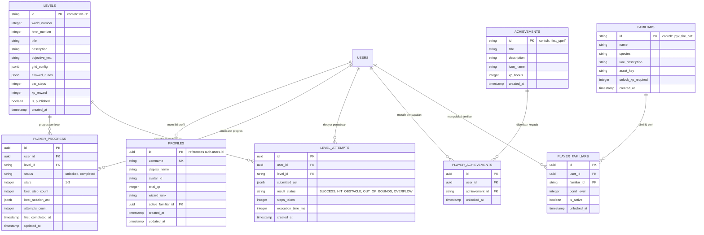

# SPELLCODE: DATABASE DESIGN SPECIFICATION
*Perancangan Skema PostgreSQL Supabase, Keamanan RLS, dan Struktur Data Offline*

---

## 1. Diagram Relasi Entitas (Entity-Relationship Diagram)



---

## 2. Definisi Skema Tabel PostgreSQL

### 2.1 Tabel `profiles`
Menyimpan identitas anak dalam dunia sihir, total pengalaman (XP), dan tingkatan penyihir.

```sql
CREATE TABLE public.profiles (
    id UUID PRIMARY KEY REFERENCES auth.users(id) ON DELETE CASCADE,
    username VARCHAR(30) UNIQUE NOT NULL,
    display_name VARCHAR(50) NOT NULL,
    avatar_id VARCHAR(50) DEFAULT 'apprentice_default',
    total_xp INTEGER NOT NULL DEFAULT 0 CHECK (total_xp >= 0),
    wizard_rank VARCHAR(30) NOT NULL DEFAULT 'Novice Conjurer',
    active_familiar_id VARCHAR(50) DEFAULT 'pyx_fire_cat',
    created_at TIMESTAMPTZ NOT NULL DEFAULT timezone('utc'::text, now()),
    updated_at TIMESTAMPTZ NOT NULL DEFAULT timezone('utc'::text, now())
);
```

### 2.2 Tabel `levels`
Katalog konfigurasi level permainan yang bersifat deklaratif.

```sql
CREATE TABLE public.levels (
    id VARCHAR(50) PRIMARY KEY, -- format standar: 'w1-l1', 'w1-l2', ..., 'w2-l7'
    world_number SMALLINT NOT NULL CHECK (world_number > 0),
    level_number SMALLINT NOT NULL CHECK (level_number > 0),
    title VARCHAR(100) NOT NULL,
    description TEXT NOT NULL,
    objective_text VARCHAR(255) NOT NULL,
    grid_config JSONB NOT NULL, -- struktur: { width, height, playerStart, obstacles, shards, portal }
    allowed_runes JSONB NOT NULL, -- array: ['STEP_FORWARD', 'TURN_LEFT', 'TURN_RIGHT']
    par_steps INTEGER NOT NULL CHECK (par_steps > 0), -- standar langkah untuk 3 bintang
    base_xp INTEGER NOT NULL DEFAULT 50 CHECK (base_xp >= 0), -- Base XP (50) sebelum bonus bintang
    is_published BOOLEAN NOT NULL DEFAULT true,
    created_at TIMESTAMPTZ NOT NULL DEFAULT timezone('utc'::text, now()),
    CONSTRAINT uq_world_level UNIQUE (world_number, level_number)
);
```

### 2.3 Tabel `player_progress`
Status kemajuan pemain pada masing-masing level (apakah sudah terbuka, bintang yang diperoleh, dan solusi terbaik).

```sql
CREATE TABLE public.player_progress (
    id UUID PRIMARY KEY DEFAULT gen_random_uuid(),
    user_id UUID NOT NULL REFERENCES public.profiles(id) ON DELETE CASCADE,
    level_id VARCHAR(50) NOT NULL REFERENCES public.levels(id) ON DELETE CASCADE,
    status VARCHAR(20) NOT NULL DEFAULT 'unlocked' CHECK (status IN ('unlocked', 'completed')),
    stars SMALLINT NOT NULL DEFAULT 0 CHECK (stars BETWEEN 0 AND 3),
    best_step_count INTEGER DEFAULT NULL,
    best_solution_ast JSONB DEFAULT NULL,
    attempts_count INTEGER NOT NULL DEFAULT 1 CHECK (attempts_count >= 1),
    first_completed_at TIMESTAMPTZ DEFAULT NULL,
    updated_at TIMESTAMPTZ NOT NULL DEFAULT timezone('utc'::text, now()),
    CONSTRAINT uq_user_level UNIQUE (user_id, level_id)
);
```

### 2.4 Tabel `level_attempts`
Log analitik setiap kali anak menekan tombol jalankan mantra (*Cast Spell*). Berguna untuk mendeteksi kesulitan level dan riset pedagogis.

```sql
CREATE TABLE public.level_attempts (
    id UUID PRIMARY KEY DEFAULT gen_random_uuid(),
    user_id UUID NOT NULL REFERENCES public.profiles(id) ON DELETE CASCADE,
    level_id VARCHAR(50) NOT NULL REFERENCES public.levels(id) ON DELETE CASCADE,
    submitted_ast JSONB NOT NULL,
    result_status VARCHAR(30) NOT NULL CHECK (result_status IN ('SUCCESS', 'HIT_OBSTACLE', 'OUT_OF_BOUNDS', 'OVERFLOW', 'MISSED_OBJECTIVE')),
    steps_taken INTEGER NOT NULL CHECK (steps_taken >= 0),
    execution_time_ms INTEGER NOT NULL DEFAULT 0,
    created_at TIMESTAMPTZ NOT NULL DEFAULT timezone('utc'::text, now())
);
```

### 2.5 Tabel `achievements` & `player_achievements`
Penghargaan pencapaian untuk memotivasi anak belajar (misal: "Mantra Pertama", "Ahli Pengulangan").

```sql
CREATE TABLE public.achievements (
    id VARCHAR(50) PRIMARY KEY,
    title VARCHAR(100) NOT NULL,
    description TEXT NOT NULL,
    icon_name VARCHAR(50) NOT NULL,
    xp_bonus INTEGER NOT NULL DEFAULT 100,
    created_at TIMESTAMPTZ NOT NULL DEFAULT timezone('utc'::text, now())
);

CREATE TABLE public.player_achievements (
    id UUID PRIMARY KEY DEFAULT gen_random_uuid(),
    user_id UUID NOT NULL REFERENCES public.profiles(id) ON DELETE CASCADE,
    achievement_id VARCHAR(50) NOT NULL REFERENCES public.achievements(id) ON DELETE CASCADE,
    unlocked_at TIMESTAMPTZ NOT NULL DEFAULT timezone('utc'::text, now()),
    CONSTRAINT uq_user_achievement UNIQUE (user_id, achievement_id)
);
```

### 2.6 Tabel `familiars` & `player_familiars`
Koleksi makhluk pendamping sihir yang memberikan petunjuk dan ikatan emosional.

```sql
CREATE TABLE public.familiars (
    id VARCHAR(50) PRIMARY KEY,
    name VARCHAR(50) NOT NULL,
    species VARCHAR(50) NOT NULL,
    lore_description TEXT NOT NULL,
    asset_key VARCHAR(100) NOT NULL,
    unlock_xp_required INTEGER NOT NULL DEFAULT 0,
    created_at TIMESTAMPTZ NOT NULL DEFAULT timezone('utc'::text, now())
);

CREATE TABLE public.player_familiars (
    id UUID PRIMARY KEY DEFAULT gen_random_uuid(),
    user_id UUID NOT NULL REFERENCES public.profiles(id) ON DELETE CASCADE,
    familiar_id VARCHAR(50) NOT NULL REFERENCES public.familiars(id) ON DELETE CASCADE,
    bond_level INTEGER NOT NULL DEFAULT 1 CHECK (bond_level >= 1),
    is_active BOOLEAN NOT NULL DEFAULT false,
    unlocked_at TIMESTAMPTZ NOT NULL DEFAULT timezone('utc'::text, now()),
    CONSTRAINT uq_user_familiar UNIQUE (user_id, familiar_id)
);
```

---

## 3. Kebijakan Keamanan Row Level Security (RLS)

Keamanan data pemain dijamin pada layer database Postgres menggunakan Supabase RLS:

```sql
-- Aktifkan RLS di setiap tabel
ALTER TABLE public.profiles ENABLE ROW LEVEL SECURITY;
ALTER TABLE public.levels ENABLE ROW LEVEL SECURITY;
ALTER TABLE public.player_progress ENABLE ROW LEVEL SECURITY;
ALTER TABLE public.level_attempts ENABLE ROW LEVEL SECURITY;
ALTER TABLE public.achievements ENABLE ROW LEVEL SECURITY;
ALTER TABLE public.player_achievements ENABLE ROW LEVEL SECURITY;
ALTER TABLE public.familiars ENABLE ROW LEVEL SECURITY;
ALTER TABLE public.player_familiars ENABLE ROW LEVEL SECURITY;

-- 1. Kebijakan Profil:
-- Siapapun yang terotentikasi dapat membaca profil publik
CREATE POLICY "Profiles can be viewed by anyone" 
ON public.profiles FOR SELECT USING (true);

-- Pengguna hanya dapat memperbarui profil miliknya sendiri
CREATE POLICY "Users can update own profile" 
ON public.profiles FOR UPDATE USING (auth.uid() = id);

-- 2. Kebijakan Levels:
-- Seluruh level yang dipublikasikan dapat dibaca oleh publik (termasuk tamu)
CREATE POLICY "Published levels are readable by everyone" 
ON public.levels FOR SELECT USING (is_published = true);

-- 3. Kebijakan Player Progress:
-- Pengguna hanya dapat melihat dan menulis progresnya sendiri
CREATE POLICY "Users can read own progress" 
ON public.player_progress FOR SELECT USING (auth.uid() = user_id);

CREATE POLICY "Users can insert own progress" 
ON public.player_progress FOR INSERT WITH CHECK (auth.uid() = user_id);

CREATE POLICY "Users can update own progress" 
ON public.player_progress FOR UPDATE USING (auth.uid() = user_id);

-- 4. Kebijakan Level Attempts:
-- Pengguna hanya dapat melihat dan mencatat percobaan miliknya
CREATE POLICY "Users can insert own attempts" 
ON public.level_attempts FOR INSERT WITH CHECK (auth.uid() = user_id);

CREATE POLICY "Users can view own attempts" 
ON public.level_attempts FOR SELECT USING (auth.uid() = user_id);

-- 5. Kebijakan Achievements & Familiars Katalog:
CREATE POLICY "Achievements readable by all" 
ON public.achievements FOR SELECT USING (true);

CREATE POLICY "Familiars readable by all" 
ON public.familiars FOR SELECT USING (true);

CREATE POLICY "Users can view own achievements" 
ON public.player_achievements FOR SELECT USING (auth.uid() = user_id);

CREATE POLICY "Users can view own familiars" 
ON public.player_familiars FOR SELECT USING (auth.uid() = user_id);
```

---

## 4. Indexing untuk Performa Tinggi

```sql
CREATE INDEX idx_levels_world_level ON public.levels (world_number, level_number);
CREATE INDEX idx_player_progress_user_level ON public.player_progress (user_id, level_id);
CREATE INDEX idx_level_attempts_user_level ON public.level_attempts (user_id, level_id, created_at DESC);
CREATE INDEX idx_player_familiars_user ON public.player_familiars (user_id);
```

---

## 5. Struktur Data Offline & Mode Tamu (Guest Mode LocalStorage)

Untuk memastikan anak dapat langsung bermain tanpa harus login terlebih dahulu, antarmuka menyediakan *Local Mirror Storage* dengan skema JSON identik:

### Kunci LocalStorage: `spellcode_guest_v1`
```json
{
  "profile": {
    "username": "Magang_Pintar",
    "displayName": "Penyihir Baru",
    "avatarId": "apprentice_default",
    "totalXp": 120,
    "wizardRank": "Novice Conjurer",
    "activeFamiliarId": "pyx_fire_cat"
  },
  "progress": {
    "w1-l1": {
      "status": "completed",
      "stars": 3,
      "bestStepCount": 4,
      "bestSolutionAst": { "version": 1, "nodes": [] },
      "attemptsCount": 2,
      "firstCompletedAt": "2026-10-13T08:00:00Z"
    },
    "w1-l2": {
      "status": "unlocked",
      "stars": 0,
      "attemptsCount": 0
    }
  },
  "familiars": ["pyx_fire_cat"],
  "achievements": ["first_spell"]
}
```

### Mekanisme Sinkronisasi Saat Anak Mendaftar (Account Claim)
Saat anak atau orang tua memutuskan untuk membuat akun cloud:
1. Sistem membaca objek `spellcode_guest_v1` dari LocalStorage browser.
2. Mengirimkan payload batch ke server endpoint `/api/sync-guest-progress`.
3. Server memvalidasi dan melakukan upsert ke tabel `player_progress`, `profiles`, dan `player_familiars`.
4. Menghapus atau menandai cache lokal sebagai *synced* untuk menghindari duplikasi XP.
