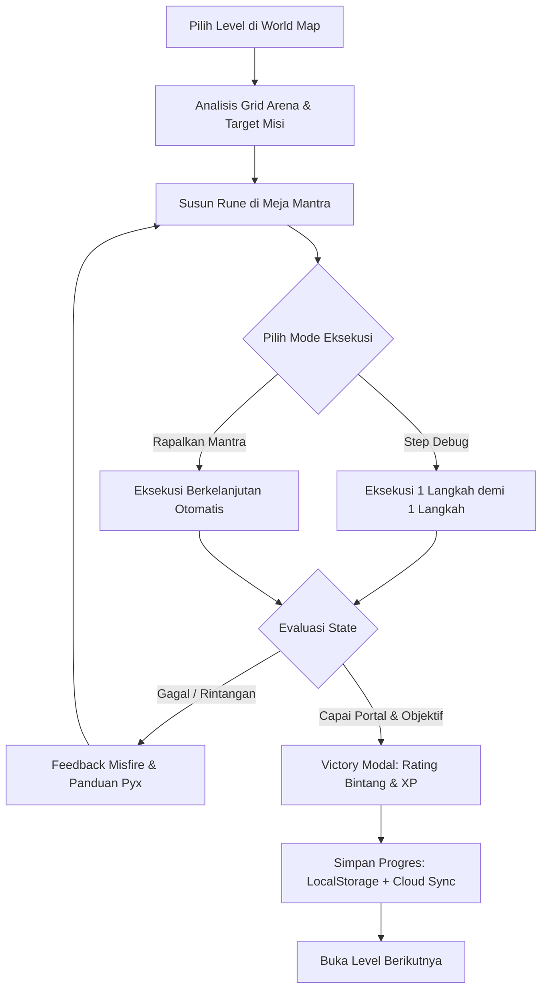

# SPELLCODE: PRODUCT REQUIREMENTS DOCUMENT (PRD)

**Nama Produk:** SpellCode  
**Tagline:** Belajar Coding dengan Merapalkan Mantra Sihir  
**Target Pengguna:** Anak Usia Sekolah Dasar (7-12 Tahun), Guru Komputer, dan Orang Tua  
**Platform:** Web Application Responsif (Desktop, Tablet, Mobile)  
**Dokumen Terkait:** [ACCEPTANCE_CRITERIA.md](file:///c:/XII%20SIJA%202/lomab-vibecoding/docs/ACCEPTANCE_CRITERIA.md), [TECHNICAL_ARCHITECTURE.md](file:///c:/XII%20SIJA%202/lomab-vibecoding/docs/TECHNICAL_ARCHITECTURE.md), [DESIGN_SYSTEM.md](file:///c:/XII%20SIJA%202/lomab-vibecoding/docs/DESIGN_SYSTEM.md)

---

## 1. Visi dan Misi Produk

### 1.1 Visi
Menghadirkan lingkungan belajar pemrograman yang imersif, menyenangkan, dan ramah anak, di mana konsep ilmu komputer abstrak diwujudkan sebagai mantra sihir interaktif yang dijalankan di arena permainan petualangan fantasi.

### 1.2 Misi
1. **Demistifikasi Logika Komputasi:** Mengubah konsep *computational thinking* (sekuensial, perulangan, percabangan kondisi, efisiensi algoritma) menjadi balok mantra sihir (Maju, Putar, Nyalakan Lentera, Ambil Kristal, Perulangan / Repeat, dan Sensor Jika / If).
2. **Eksplorasi Aman Tanpa Takut Salah:** Menghilangkan ketakutan terhadap pesan kesalahan (*syntax error*) dengan feedback visual ramah anak, partikel kegagalan kartun (*misfire* yang lucu), dan panduan debugging bertahap dari karakter pendamping (Pyx si Kucing Api).
3. **Mekanik Nyata Berbasis Eksekusi Kode:** Menolak ilusi game kosmetik: setiap gerakan karakter dan pemecahan rintangan didorong langsung oleh *Abstract Syntax Tree (AST)* dan mesin virtual deterministik.
4. **Aksesibilitas dan Keterjangkauan:** Dapat dimainkan di berbagai perangkat (tablet, ponsel, laptop sekolah) tanpa hambatan instalasi (*zero-friction web application*).

---

## 2. Profil Pengguna dan Persona

### Persona 1: Arya (8 Tahun) - Murid Kelas 2 SD (The Visual Explorer)
* **Karakteristik:** Menyukai visual penuh warna, animasi interaktif, dan efek suara kartun. Belum terbiasa membaca instruksi teknis yang panjang.
* **Kebutuhan:**
  * Ikon visual yang intuitif dengan label teks singkat dan ramah.
  * Umpan balik langsung per langkah (*step-by-step debugger*) untuk memahami alur instruksi.
  * Karakter pendamping (*Familiar*) yang memberikan petunjuk kontekstual.
* **Pain Point:** Cepat frustrasi jika ada pesan error teknis yang membingungkan.

### Persona 2: Bella (11 Tahun) - Murid Kelas 5 SD (The Logical Tinkerer)
* **Karakteristik:** Mampu berpikir sekuensial dan analitis, menyukai tantangan puzzle, termotivasi mendapatkan skor sempurna.
* **Kebutuhan:**
  * Sistem penilaian bintang berdasarkan efisiensi kode (*Par Steps / Optimal Runes*).
  * Pengenalan struktur logika yang lebih dalam (looping terulang dan deteksi kondisi bersarang).
  * Modul eksplorasi (*Grimoire / Kitab Mantra*) untuk menguji kombinasi algoritma.
* **Pain Point:** Cepat jenuh jika puzzle terlalu linear tanpa target optimasi efisiensi.

### Persona 3: Ibu Maya & Guru Komputer (The Facilitator / Mentors)
* **Karakteristik:** Orang tua atau pendidik yang menginginkan media edukasi bermakna tanpa risiko keamanan data anak.
* **Kebutuhan:**
  * Mode Tamu kilat (*Guest Mode first*) tanpa kewajiban registrasi yang merepotkan di kelas.
  * Keamanan privasi anak: bebas iklan komersial, bebas chat publik tanpa filter.
  * Opsi sinkronisasi cloud jika anak ingin melanjutkan progres di rumah.

---

## 3. Struktur Dunia dan Kurikulum Pembelajaran

SpellCode dirancang dengan 3 Dunia Tematik, mencakup total 18 Level terkurasi:

### World 1: Hutan Pemula (The Enchanted Forest) - 6 Level
* **Fokus Pembelajaran:** Logika Sekuensial (*Sequence*), Dekomposisi Masalah, dan Orientasi Spasial (Arah Hadap Kiri/Kanan).
* **Rune yang Digunakan:** `Maju 1 Langkah`, `Putar Kiri (90°)`, `Putar Kanan (90°)`, `Nyalakan Lentera`.
* **Prasyarat Buka World 2:** Menyelesaikan World 1 dengan akumulasi minimal 14 Bintang.

### World 2: Gua Kristal (The Crystal Caverns) - 6 Level
* **Fokus Pembelajaran:** Perulangan (*Loops & Patterns*), Pengenalan Pola Berulang, dan Efisiensi Eksekusi Kode.
* **Rune Tambahan:** `Ulangi N Kali (Repeat Block)`, `Ambil Kristal`.
* **Prasyarat Buka World 3:** Menyelesaikan World 2 dengan akumulasi minimal 30 Bintang.

### World 3: Benteng Awan (The Nimbus Citadel) - 6 Level
* **Fokus Pembelajaran:** Percabangan Kondisional (*Conditionals: If / Else*), Sensor Lingkungan (Deteksi Jurang, Deteksi Kabut, Deteksi Objek), dan Perulangan Bersarang (*Nested Constructs*).
* **Rune Tambahan:** `Jika (If Condition)`, `Sensor Kabut`, `Sensor Jurang`, `Sensor Kristal`.

---

## 4. Mekanik Utama Game (Core Gameplay Loop)

### 4.1 Meja Mantra (Spell Deck)
* Area kerja tempat pemain menyusun balok logika secara visual.
* Dilengkapi fitur susun ulang (geser naik / turun), hapus satuan, dan kosongkan meja mantra dengan konfirmasi pengaman.
* Menampilkan jumlah blok terpakai serta indikator efisiensi target par.

### 4.2 Arena Visual 2D Deterministik
* Grid petak interaktif yang menampilkan posisi karakter penyihir, rintangan (batu, dinding, jurang), objek interaktif (lentera api, kristal mana), dan portal tujuan.
* Setiap aksi memiliki animasi gerak dan efek audio unik (*footstep, turn whoosh, torch ignites, crystal chimes*).

### 4.3 Sistem Evaluasi Bintang
* **1 Bintang (Penyelesaian Dasar):** Karakter berhasil mencapai portal tujuan dan mengaktifkan seluruh objektif wajib.
* **2 Bintang (Efisiensi Cukup):** Menyelesaikan misi dengan jumlah instruksi atau langkah di bawah batas toleransi.
* **3 Bintang (Mastery / Par Optimal):** Menyelesaikan misi dengan jumlah langkah dan blok paling optimal (`stepsTaken <= parSteps`).

---

## 5. Sistem Progresi dan Mode Akun

### 5.1 Mode Tamu (Guest Mode)
* Langsung aktif saat pengguna pertama kali membuka website.
* Data profil lokal, progres bintang, riwayat percobaan, dan draf kode tersimpan di browser via `localStorage` (`spellcode_guest_v1`).
* Pemain dapat menikmati 100% konten gameplay tanpa harus mendaftar atau memasukkan email.

### 5.2 Akun Cloud (Supabase Auth & Database)
* Memberikan persistensi permanen di cloud dan kemampuan sinkronisasi lintas perangkat (misalnya dari tablet sekolah ke laptop rumah).
* Tautan konversi akun tamu ke akun cloud tanpa menghapus progres yang sudah dicapai.

### 5.3 Sistem Gelar Penyihir (Wizard Ranks)
* **0 - 199 XP:** *Novice Conjurer* (Penyihir Pemula)
* **200 - 499 XP:** *Apprentice Elementalist* (Magang Elemen)
* **500 - 999 XP:** *Rune Weaver* (Penjalin Rune)
* **1000+ XP:** *Master Spellcoder* (Master Mantra)

---

## 6. Persyaratan Non-Fungsional (Aksesibilitas & Kualitas)

1. **Aksesibilitas Keyboard & Focus Management (WCAG 2.1 AA):**
   * Seluruh tombol interaktif memiliki `focus-visible` ring kontras tinggi.
   * Modal dialog dilengkapi *focus trap* siklikal (Tab / Shift+Tab) dan penutupan dengan tombol Escape.
2. **Preferensi Reduced Motion:**
   * Menghormati pengaturan sistem operasi pengguna melalui media query CSS `@media (prefers-reduced-motion: reduce)`.
3. **Responsivitas Perangkat:**
   * Layout adaptif untuk layar desktop (>= 1024px), tablet (768px - 1023px), dan ponsel (< 768px) dengan tab switcher arena/editor mantra.
4. **Ketahanan Jaringan (Offline-First):**
   * Seluruh simulasi logika level dan pustaka audio berjalan 100% di sisi klien tanpa ketergantungan koneksi internet aktif.

---

## 7. Batasan Ruang Lingkup MVP (Out-of-Scope)
* **Fitur Multiplayer Realtime:** Ditiadakan demi menjaga fokus pada kurikulum komputasi fundamental.
* **Fitur Obrolan Bebas (Chat):** Ditiadakan untuk menjamin keamanan dan privasi anak (*Child Safety*).
* **AI Chatbot Generatif:** Digantikan dengan sistem panduan kurasi deterministik Pyx untuk menjamin akurasi edukatif tanpa latensi atau risiko halusinasi teks.
