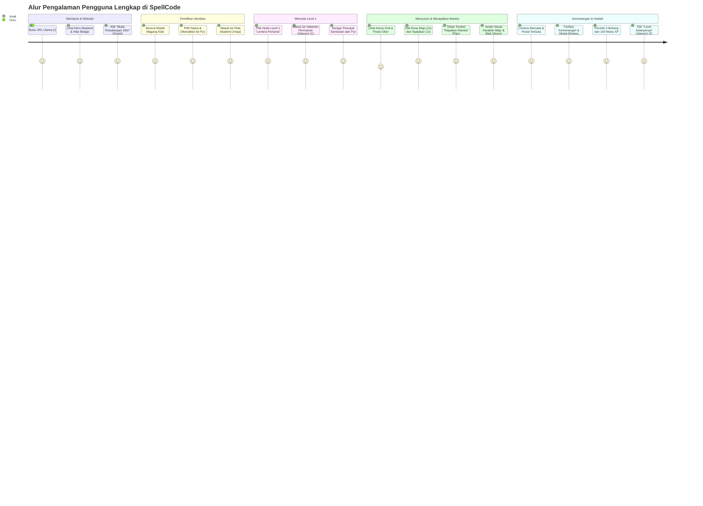

# SPELLCODE: PRODUCT SPECIFICATION & GAME DESIGN DOCUMENT
*Dokumen Spesifikasi Produk & Perancangan Game Edukasi Pemrograman Anak (Usia 7-12 Tahun)*

---

## 1. Visi dan Misi Produk

### 1.1 Visi
Menghadirkan lingkungan belajar pemrograman yang imersif, menyenangkan, dan berdaya guna bagi anak-anak usia sekolah dasar (7-12 tahun), di mana konsep ilmu komputer abstrak diwujudkan sebagai mantra sihir interaktif yang dijalankan di dunia nyata permainan.

### 1.2 Misi
1. **Demistifikasi Logika Komputasi**: Mengubah konsep *computational thinking* (urutan, perulangan, kondisi, fungsi) menjadi mekanik manipulasi sihir (Cast, Repeat Rune, Elemental Wards).
2. **Eksplorasi Aman Tanpa Takut Salah**: Menghilangkan ketakutan terhadap pesan kesalahan (*syntax error*) dengan visual feedback ramah anak dan panduan debugging bertahap.
3. **Mekanik Nyata Berbasis Eksekusi Kode**: Menolak ilusi game di mana aksi hanya animasi kosmetik; setiap gerakan karakter, aktivasi elemen, dan pemecahan teka-teki didorong langsung oleh *Abstract Syntax Tree (AST)* dan mesin virtual deterministik.
4. **Aksesibilitas dan Keterjangkauan**: Memastikan game dapat dimainkan di berbagai perangkat sekolah/rumah (tablet, laptop low-spec, desktop) melalui web modern tanpa instalasi rumit.

---

## 2. Analisis Pengguna dan Persona

### Persona 1: Arya (8 Tahun) - Murid Kelas 2 SD (The Visual Explorer)
* **Karakteristik**: Menyukai visual cerah, animasi interaktif, dan efek suara kartun. Belum terbiasa membaca kalimat instruksi yang panjang. Sangat rentan frustrasi jika melihat pesan teks error bergaya teknis.
* **Kebutuhan**:
  * Ikon visual yang intuitif dengan label teks singkat dan bersahabat.
  * Umpan balik langsung (animasi langkah per langkah) agar mengerti aksi apa yang salah.
  * Panduan suara/visual dari karakter pendamping (*Familiar Companion*).
* **Pain Point**: Kebingungan jika puzzle terlalu rumit tanpa demonstrasi awal (*guided tutorial*).

### Persona 2: Bella (11 Tahun) - Murid Kelas 5 SD (The Logical Tinkerer)
* **Karakteristik**: Sudah mampu berpikir logis sekuensial, menyukai teka-teki yang menantang, bangga jika bisa menyelesaikan masalah dengan solusi paling efisien.
* **Kebutuhan**:
  * Sistem penilaian bintang berdasarkan efisiensi kode (*Par Steps / Optimal Runes*).
  * Pengenalan konsep abstrak seperti loops berulang dan efisiensi algoritma.
  * Fitur eksperimen (*Grimoire / Sandbox*) untuk meramu mantra mandiri.
* **Pain Point**: Cepat bosan jika level terlalu repetitif atau tidak ada target penyelesaian optimal.

### Persona 3: Ibu Maya (Orang Tua) & Pak Budi (Guru Komputer SD) (The Mentors)
* **Karakteristik**: Orang tua atau guru yang ingin anak/muridnya melek teknologi secara bermakna, bukan sekadar bermain game pasif.
* **Kebutuhan**:
  * Kemudahan anak bermain langsung tanpa registrasi berbelit (*Guest Mode first*).
  * Laporan progres kemampuan berpikir komputasional yang mudah dipahami.
  * Lingkungan aman anak: tanpa iklan luar, tanpa tautan berbahaya, privasi data terlindungi.
* **Pain Point**: Aplikasi yang mengharuskan memasukkan nomor telepon atau akun media sosial yang berisiko bagi privasi anak.

---

## 3. User Journey Terperinci: Dari Mendarat Hingga Level Pertama

### Langkah demi Langkah Alur Pengguna Baru:
1. **Langkah 1 (Landing Page - `/`)**:
   * Anak melihat pemandangan kastil akademi sihir terapung dengan animasi partikel halus.
   * Judul utama: *"SpellCode: Belajar Coding dengan Merapalkan Mantra Sihir!"*
   * Tombol CTA Primer besar: **"Mulai Petualangan Sihir"** (langsung membawa ke game tanpa login).
   * Tombol CTA Sekunder: **"Masuk Akademi"** (untuk pengguna yang sudah memiliki akun cloud).
2. **Langkah 2 (Modal Sambutan Magang Kilat)**:
   * Jika belum ada data lokal, anak disapa oleh **Pyx si Kucing Api**: *"Halo calon penyihir! Siapa nama panggilanmu di akademi?"*
   * Input nama magang (sudah terisi default ramah: `Penyihir Cilik`, dapat diubah).
   * Tombol: **"Buka Gerbang Akademi"** -> menyimpan profil ke `localStorage` dan berpindah ke `/map`.
3. **Langkah 3 (Peta Akademi - `/map`)**:
   * Menampilkan pulau terapung **World 1: Whispering Woods**, **World 2: Crystal Caverns**, dan **World 3: Cloud Citadel**.
   * Node Level 1 ("Langkah Pertama Magang") berpijar aktif dengan animasi denyut (*pulse*).
   * Node Level 2 sampai 6 berstatus terkunci dengan ikon gembok kecil.
   * Header menampilkan avatar, nama magang, gelar `Novice Conjurer`, dan 0 Mana XP.
   * Anak menekan Node Level 1 -> navigasi ke `/play/w1-l1`.
4. **Langkah 4 (Arena Permainan Level 1 - `/play/w1-l1`)**:
   * **Grid Viewport**: Karakter penyihir di koordinat (0, 1) menghadap Timur. Portal kemenangan di petak (3, 1).
   * **Rak Rune**: Tersedia blok `Maju 1 Langkah`.
   * **Meja Mantra**: Kosong, dengan teks panduan: *"Klik atau tarik rune ke sini untuk meramu mantra!"*
   * **Petunjuk Pyx**: *"Ayo langkahkan penyihir menuju portal! Susun blok Maju 3 kali."*
5. **Langkah 5 (Eksekusi Mantra & Kemenangan)**:
   * Anak memasukkan 3 blok `Maju`.
   * Anak menekan tombol hijau **"Rapalkan Mantra"**.
   * Karakter bergerak langkah demi langkah di grid; blok di meja mantra menyala kuning mengikuti gerakan.
   * Portal bersinar cerah dan terompet kemenangan dibunyikan.
   * Modal Victory muncul: 3 Bintang, 50 XP, dan tombol **"Lanjut ke Level 2"**.

---

## 4. Struktur Halaman & Fitur MVP

Untuk menjamin kualitas tinggi dan fokus demonstrasi lomba, antarmuka MVP difokuskan pada 6 halaman inti:

### 4.1 Halaman Utama (`/`)
* Hero Section dengan ilustrasi ramah anak dan kurikulum 18 Level di 3 Realm.
* 3 Pilar Edukasi: *Berpikir Logis*, *Tanpa Frustrasi Sintaks*, *Mekanik Pemrograman Nyata*.
* CTA langsung ke petualangan tanpa paksaan registrasi.

### 4.2 Peta Akademi (`/map`)
* Visualisasi pulau terapung World 1 (Whispering Woods, 6 level), World 2 (Crystal Caverns, 6 level), dan World 3 (Cloud Citadel, 6 level).
* Indikator bintang per level (0-3 bintang) dan status gembok terbuka/terkunci dengan dialog ramah anak.
* Akses cepat ke Grimoire dan Profil dari bilah navigasi atas.

### 4.3 Arena Permainan (`/play/[levelId]`)
* **Area Kiri: Viewport Grid 2D**:
  * Grid petak berukuran responsif (misal 5x5 atau 6x6 petak).
  * Objek: Magang sihir, kristal energi, lentera suci, portal tujuan, semak/batu rintangan.
* **Area Kanan: Meja Mantra (Spell Deck)**:
  * Urutan langkah bernomor rapi (1, 2, 3, ...).
  * Tombol hapus blok per baris dan tombol bersihkan meja (*Clear*).
  * Visual active step highlight saat eksekusi berjalan.
* **Area Bawah/Samping: Rak Rune (Block Tray)**:
  * Pilihan blok yang diizinkan pada level tersebut (Maju, Putar Kiri, Putar Kanan, Nyalakan Lentera, Ambil Kristal, Perulangan/Repeat).
* **Bilah Kontrol**:
  * Tombol **Rapalkan Mantra (Play)**: Eksekusi otomatis dari awal hingga akhir.
  * Tombol **Satu Langkah (Step)**: Eksekusi satu baris instruksi untuk keperluan debugging.
  * Tombol **Reset Posisi**: Mengembalikan karakter ke titik awal tanpa menghapus blok kode.
  * Slider Kecepatan: 1x (normal), 2x (cepat).
  * Tombol Mute Audio: Mengaktifkan/mematikan SFX.
  * Tombol Bantuan: Membuka petunjuk bertahap dari Familiar.

### 4.4 Buku Mantra / Grimoire (`/grimoire`)
* Ensiklopedia rune sihir: Penjelasan setiap mantra dalam bahasa anak yang mudah dipahami.
* Profil Familiar: Menampilkan status ikatan dengan Pyx si Kucing Api dan pratinjau Familiar lain yang akan terbuka di level selanjutnya.

### 4.5 Profil & Statistik Magang (`/profile`)
* Kartu identitas penyihir cilik: Nama, Avatar, Gelar Sihir (*Wizard Rank*).
* Statistik: Total Bintang, Total Mana XP, Total Level Selesai.
* Tombol **"Hubungkan ke Akun Cloud"** bagi pemain tamu yang ingin menyimpan progres permanen.

### 4.6 Autentikasi Ramah Anak (`/login`)
* Formulir masuk tanpa sandi rumit (Magic Link / Kode Akses Sederhana via Email).
* Opsi kembali ke permainan sebagai tamu kapan saja dengan satu klik.

---

## 5. Kurikulum Computational Thinking untuk Anak SD (7-12 Tahun)

| Konsep Ilmu Komputer | Istilah Sihir di Game | Implementasi di MVP | Sasaran Pedagogis |
|---|---|---|---|
| **Sequencing (Urutan Instruksi)** | Runtutan Mantra (*Spell Sequence*) | World 1 (Level 1-6): Maju, Putar Kiri, Putar Kanan, Nyalakan Lentera | Mengajarkan bahwa urutan langkah menentukan keberhasilan program; salah satu langkah menyebabkan mantra gagal. |
| **Loops & Repetition (Perulangan)** | Lingkaran Sihir (*Repeat Rune*) | World 2 (Level 7-12): Blok `repeat(N) { ... }` membungkus beberapa aksi | Mengenali pola berulang (*pattern recognition*) dan menghargai efisiensi kode (menyusun 4 blok berulang dibanding 16 blok manual). |
| **Conditionals & Sensors (Kondisi Logika)** | Perlindungan Elemen (*Elemental Wards*) | World 3 (Level 13-18): Blok `if (kondisi) { ... }` dan sensor jalan/jurang | Mengambil keputusan otomatis berdasarkan kondisi lingkungan sekitar sebelum melangkah. |
| **Debugging Interaktif** | Penyelidikan Misfire (*Spell Inspection*) | Tombol "Satu Langkah" (Step) dan sorotan warna kuning pada blok yang sedang bergerak | Melatih dekomposisi masalah: menelusuri langkah demi langkah untuk menemukan di mana letak kesalahan belokan. |

---

## 6. Formula Sistem Bintang, Mana XP, dan Kenaikan Pangkat

### 6.1 Formula Penilaian Bintang
Setiap level memiliki nilai standar langkah optimal (`par_steps`):
* **3 Bintang**: `steps_taken <= par_steps` (Solusi paling ringkas dan optimal).
* **2 Bintang**: `par_steps < steps_taken <= (par_steps + 2)` (Solusi berhasil dengan sedikit redundansi).
* **1 Bintang**: `steps_taken > (par_steps + 2)` (Solusi berhasil menyelesaikan semua objektif walaupun berputar-putar).

### 6.2 Formula Mana XP
* Penyelesaian pertama kali level:
  * 3 Bintang: `100 XP` (50 Base XP + 50 Bonus Bintang)
  * 2 Bintang: `75 XP` (50 Base XP + 25 Bonus Bintang)
  * 1 Bintang: `60 XP` (50 Base XP + 10 Bonus Bintang)
* Memainkan ulang level yang sudah selesai:
  * Pemain hanya memperoleh selisih XP jika berhasil menaikkan rating bintang (contoh: sebelumnya 1 bintang [60 XP], lalu berhasil meraih 3 bintang [100 XP], maka akun memperoleh tambahan `+40 XP`).
  * Tidak ada pengurangan XP jika hasil pengulangan lebih rendah dari rekor terbaik.

### 6.3 Tingkatan Gelar Magang (*Wizard Ranks*)
* **0 - 199 XP**: *Novice Conjurer* (Penyihir Pemula)
* **200 - 499 XP**: *Apprentice Elementalist* (Magang Elemen)
* **500 - 999 XP**: *Rune Weaver* (Penjalin Rune)
* **1000+ XP**: *Master Spellcoder* (Master Mantra)

### 6.4 Aturan Pembukaan Level (*Unlock Rules*)
* Level 1 selalu berstatus terbuka (*unlocked*).
* Level berikutnya (`Level N+1`) terbuka otomatis saat `Level N` diselesaikan dengan minimal 1 Bintang.
* World 2 (Crystal Caverns) terbuka setelah pemain mengumpulkan minimal 8 Bintang di World 1.
* World 3 (Cloud Citadel) terbuka setelah pemain mengumpulkan minimal 16 Bintang dari gabungan World 1 dan World 2.

---

## 7. Perilaku State: Gagal, Mengulang, Selesai, dan Meninggalkan Game

1. **Ketika Pemain Gagal (Menabrak Rintangan / Di Luar Batas)**:
   * Karakter tidak jatuh/mati, melainkan memunculkan partikel 'misfire' kartun dengan suara "puf" lucu.
   * Blok kode yang menyebabkan tabrakan diberi bingkai oranye lembut.
   * Balon bicara Pyx muncul: *"Aduh, kita terhalang rintangan! Coba periksa apakah kamu perlu belok sebelum melangkah."*
   * Susunan blok di meja mantra **tetap utuh dan tidak dihapus**, sehingga anak tidak frustrasi harus menyusun dari nol.
2. **Ketika Pemain Melakukan Reset Mandiri**:
   * Menekan tombol "Reset" mengembalikan karakter ke posisi awal, mereset status lentera/kristal, dan mematikan sorotan eksekusi.
   * Blok kode di meja mantra tetap tersimpan.
3. **Ketika Pemain Menyelesaikan Level (Victory)**:
   * Portal tujuan berpijar hijau cerah, karakter melompat gembira.
   * Modal Victory muncul dengan fanfare musik ceria.
   * Menampilkan jumlah bintang yang diperoleh, perbandingan langkah (`Langkahmu: 4 | Standar Par: 4`), dan bonus XP.
   * Tombol navigasi: **"Lanjut ke Level Berikutnya"**, **"Ulangi untuk Bintang Penuh"**, dan **"Kembali ke Peta"**.
4. **Ketika Pemain Meninggalkan Game di Tengah Level**:
   * Draf blok yang sedang disusun pada level aktif otomatis disimpan ke `localStorage` (`current_draft_ast`).
   * Ketika anak kembali membuka level tersebut di lain waktu, susunan blok terakhir otomatis dipulihkan.

---

## 8. Matriks Mode Tamu (Tanpa Login) vs Akun Cloud

| Fitur | Mode Tamu (Tanpa Login) | Akun Cloud Terdaftar | Rationale |
|---|---|---|---|
| **Memainkan Seluruh 18 Level** | Ya (100% Akses Penuh) | Ya | Mencegah hambatan awal; anak bisa langsung belajar tanpa izin akun berbelit. |
| **Menyimpan Progres & Bintang** | Ya (Tersimpan di LocalStorage) | Ya (Tersinkron ke Database Supabase) | Progres lokal aman selama cache browser tidak dibersihkan. |
| **Koleksi Familiar & XP** | Ya (Lokal) | Ya (Cloud) | Menjaga motivasi bermain anak tetap utuh. |
| **Buku Mantra (Grimoire)** | Ya | Ya | Referensi edukasi harus selalu bisa diakses kapan saja. |
| **Multi-Perangkat (Sinkronisasi)** | Tidak | Ya | Memungkinkan anak melanjutkan game dari tablet sekolah ke laptop rumah. |
| **Pencadangan Permanen** | Tidak | Ya | Melindungi progres jika browser dibersihkan atau perangkat berganti. |

---

## 9. Penanganan Empty State, Loading, Error, dan Offline

1. **Empty State**:
   * Meja Mantra Kosong: Ilustrasi tangan sihir halus dengan teks panduan: *"Tarik atau klik rune di bawah untuk meramu mantramu!"*
   * Belum ada lencana: Siluet lencana transparan dengan pesan: *"Selesaikan petualangan untuk membuka lencana sihir pertamamu!"*
2. **Loading State**:
   * Pergantian Level: Tirai transisi sihir dengan kristal berputar dan pesan ramah: *"Mempersiapkan arena sihir..."*
   * Verifikasi Cloud: Indikator kecil di pojok tanpa memblokir perayaan kemenangan visual anak.
3. **Error State**:
   * Loop tanpa batas: Dicegat oleh VM pada langkah ke-100 dengan pesan: *"Energi manamu habis! Periksa apakah jumlah perulanganmu terlalu banyak."*
   * Error rendering: Error Boundary menangkap kesalahan dan menampilkan tombol ramah: *"Mulai Ulang Arena"*.
4. **Offline & Gangguan Jaringan**:
   * Aplikasi beroperasi dengan prinsip *Offline-First*: seluruh logika simulasi dan definisi 18 level berjalan penuh di browser tanpa perlu koneksi internet aktif.
   * Jika jaringan mati saat verifikasi cloud, data disimpan ke antrean lokal dan disinkronkan otomatis saat jaringan pulih kembali.

---

## 10. Fitur yang Sengaja Dikecualikan dari MVP

Untuk menjaga kualitas tinggi dan fokus demonstrasi kompetisi, fitur-fitur berikut **secara sadar tidak dimasukkan ke dalam MVP**:
* **Multiplayer / PvP Realtime**: Kompleksitas sinkronisasi jaringan dan moderasi interaksi anak tidak esensial untuk kurikulum dasar.
* **Chat Bebas**: Berisiko terhadap keamanan anak (*child safety*) dan membutuhkan moderasi ketat.
* **Leaderboard Publik Terbuka**: Dapat memicu tekanan kompetitif negatif alih-alih fokus pada eksplorasi pemecahan masalah.
* **AI Tutor berbasis API Eksternal**: Membutuhkan kuota token berbayar, berisiko latensi tinggi, dan berpotensi memberikan respons yang tidak ramah anak. Semua petunjuk di MVP dibuat kurasi secara deterministik melalui dialog Familiar Pyx.
